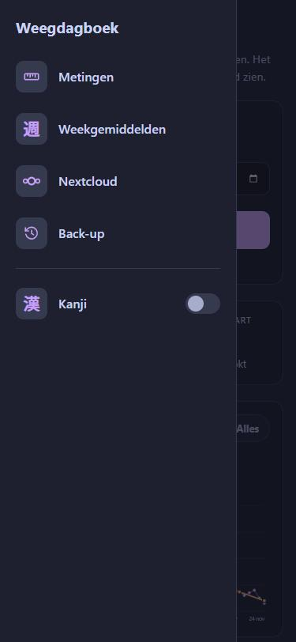
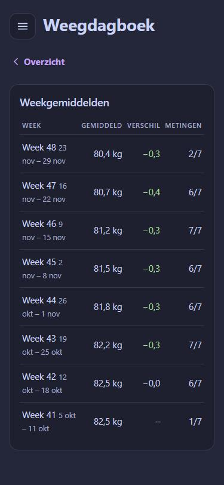

# Weegdagboek

Weegdagboek is an Android app for logging your weight once a day. It shows your daily weight and weekly average in a chart. Features: weekly averages per ISO week, a home-screen widget, optional sync to your own Nextcloud, JSON/CSV backup and an optional kanji mode. Works offline. Interface in Dutch.

> ℹ️ The programs I publish are always free and open source. I generate them with AI for no other reason than that I need and use the app myself. I publish them so that anyone can use them if they want to. Since I don't know anything about programming, I probably won't accept merge requests, but feel free to fork the project and make something great out of it.

Weegdagboek is een Android-app om elke dag je gewicht bij te houden, met een grafiek en automatische weekgemiddelden. Werkt offline; synchroniseren met je eigen Nextcloud kan, maar hoeft niet. — [English details below](#english)

<p>
  
  
  
</p>

<sub>Screenshots met voorbeelddata.</sub>

## Functies

- **Dagelijks invoeren** — gewicht en datum, één meting per dag (opnieuw opslaan overschrijft).
- **Grafiek** — dagelijkse waarden en het weekgemiddelde, over 30 dagen, 90 dagen of alles. Tik op een punt voor de details.
- **Weekgemiddelden** — automatisch per ISO-week (maandag t/m zondag), met het verschil met de week ervoor.
- **Startscherm-widget** — de grafiek van de laatste 30 dagen met je laatste gewicht en het weekgemiddelde.
- **Nextcloud-synchronisatie (optioneel)** — slaat `weegdagboek.json` op in een map op je eigen Nextcloud via WebDAV. De map wordt zo nodig aangemaakt. Wijzigingen op meerdere apparaten worden per dag samengevoegd (de nieuwste wint, ook bij verwijderen).
- **Back-up** — exporteren naar JSON of CSV en een back-up terugzetten.
- **Kanji-weergave** — een schakelaar die labels, datums en weeknummers in kanji toont (毎日, 週平均, 第48週, 11月24日 …), ook in de widget.
- **Catppuccin Macchiato**-thema met mauve als accentkleur, en een app-icoon in [Arcticons](https://github.com/Arcticons-Team/Arcticons)-stijl.

## Privacy en beveiliging

- Geen account, geen advertenties, geen tracking, geen analytics. De app maakt alleen verbinding met de Nextcloud-server die je zelf instelt.
- Metingen staan op je telefoon en, als je dat instelt, op je eigen Nextcloud.
- Inloggen gaat via **Nextcloud Login Flow v2**: je logt in je browser in en de app krijgt een eigen app-wachtwoord. Je typt nooit een wachtwoord in de app.
- Dat app-wachtwoord wordt versleuteld (AES-256-GCM) met een sleutel in de **Android Keystore** (hardware-beveiligd waar mogelijk) en komt nooit in het webgedeelte van de app.
- **Ontkoppelen** trekt het app-wachtwoord ook in bij Nextcloud.
- Tip: gebruik een aparte Nextcloud-gebruiker die alleen de Weegdagboek-map heeft, zodat een eventueel gelekt app-wachtwoord nergens anders bij kan.

## Installeren

Download de nieuwste `Weegdagboek.apk` bij **Releases**, open hem op je telefoon en sta installeren uit deze bron toe. Vereist Android 8.0 of nieuwer.

> De APK's zijn ondertekend met een ontwikkelsleutel. Een nieuwere versie installeer je gewoon over de oude heen.

## Zelf bouwen

Vereisten: JDK 17 of nieuwer en de Android SDK (platform 34).

```bash
cd android
./gradlew assembleDebug        # Windows: gradlew.bat assembleDebug
```

De APK staat daarna in `android/app/build/outputs/apk/debug/`.

## Opbouw

| Pad | Inhoud |
|---|---|
| `weegdagboek-offline.html` | De volledige app-interface (HTML/CSS/JS, zonder externe afhankelijkheden). Werkt ook los in een browser, dan zonder Nextcloud en widget. Wordt bij elke build naar de app gekopieerd. |
| `android/app/src/main/java/nl/weegdagboek/app/MainActivity.java` | WebView, brug naar de pagina (`window.WeegApp`), bestanden opslaan/kiezen. |
| `…/Nextcloud.java` | Login Flow v2, WebDAV (GET/PUT/MKCOL) en het intrekken van het app-wachtwoord. |
| `…/SecureStore.java` | Versleutelde opslag met de Android Keystore. |
| `…/WeightWidget.java` | Startscherm-widget; tekent de grafiek met `Canvas`. |

## Licentie

[GPL-3.0](LICENSE). Je mag de app gebruiken, aanpassen en verspreiden, zolang aangepaste versies ook onder de GPL-3.0 open source blijven.

Nextcloud is een handelsmerk van Nextcloud GmbH; het menu-icoon verwijst alleen naar de dienst. Catppuccin is een open source kleurenpalet (MIT).

---

## English

**Weegdagboek** ("weight diary") is a small Android app for logging your weight once a day. The interface is in Dutch, with an optional kanji mode.

- Daily entry, a chart of daily values plus the weekly average (30 days / 90 days / all), and a table of ISO-week averages.
- Home-screen widget showing the last 30 days.
- Optional sync to your own **Nextcloud** over WebDAV (`weegdagboek.json` in a folder of your choice, created if missing). Per-day last-writer-wins merge, including deletions.
- Sign-in via **Nextcloud Login Flow v2**; the resulting app password is encrypted with an **Android Keystore** key and never reaches the web layer. Unlinking revokes it on the server.
- JSON/CSV export and restore.
- No accounts, ads, trackers or analytics. Works fully offline.

Install the APK from **Releases** (Android 8.0+), or build it yourself with `cd android && ./gradlew assembleDebug`.

Licensed under the [GPL-3.0](LICENSE).
