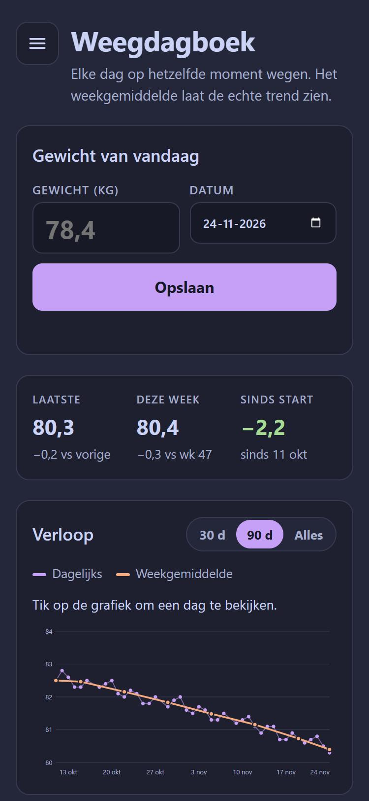

# Weegdagboek

Android app to log your weight once a day (Dutch interface).

- Chart with daily weight and weekly average
- Weekly averages table
- Home-screen widget
- Optional Nextcloud sync
- JSON/CSV backup
- Kanji mode

  
  
  

**Install:** download the APK from Releases (Android 8.0+).
**Build:** `cd android && ./gradlew assembleDebug`

> ℹ️ The programs I publish are always free and open source. I generate them with AI for no other reason than that I need and use the app myself. I publish them so that anyone can use them if they want to. Since I don't know anything about programming, I probably won't accept merge requests, but feel free to fork the project and make something great out of it.

License: [GPL-3.0](LICENSE)
